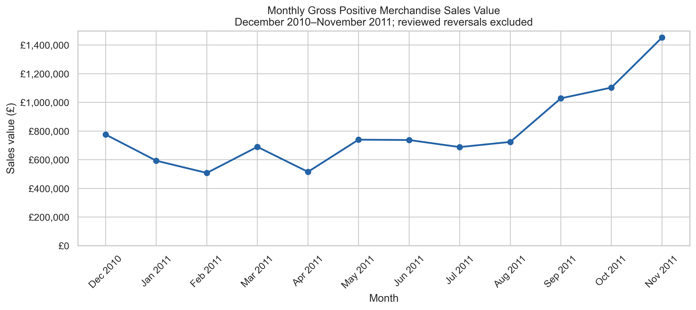
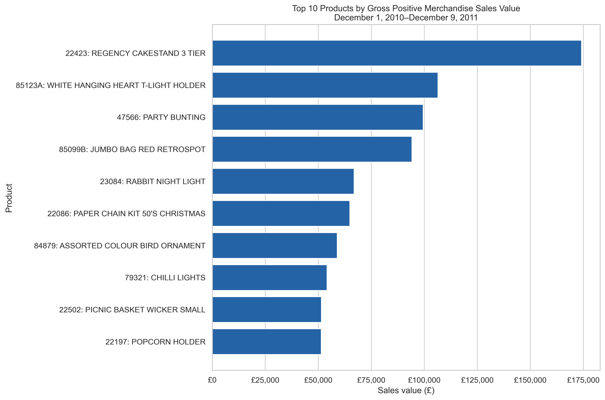
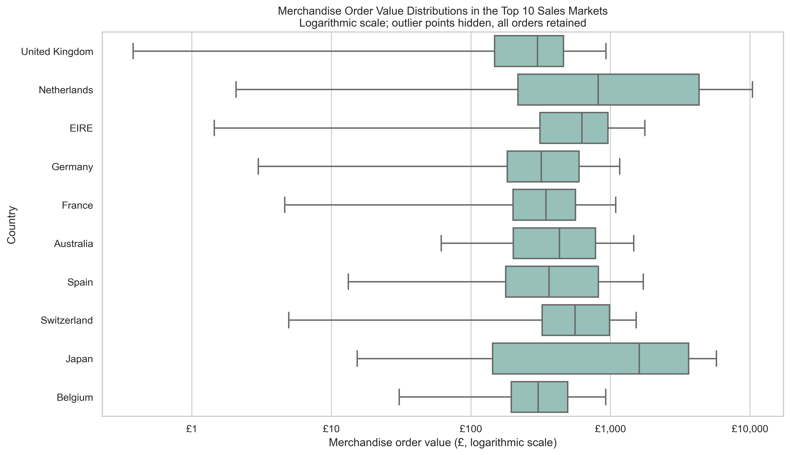

# Online Retail Sales Analysis

**Python · Pandas · Matplotlib · Seaborn · Jupyter Notebook**  
**Author:** [Henry Audi](https://github.com/dollarsaintt) | [LinkedIn](https://www.linkedin.com/in/henry-audi-b06684305/)

An end-to-end analysis of **541,909 transaction line items** from a UK-based online retailer. I inspected and prepared the data, analyzed sales trends and product performance, and created six visualizations to explain the findings.

**Start here:** [View the executed analysis notebook](online_retail_analysis.ipynb). The findings below are historical observations from this dataset, not business outcomes achieved for a client.

## Key findings

| Question | Finding |
| --- | --- |
| When were sales and orders highest? | **November 2011** led the complete months with **£1,452,115.98** in retained merchandise sales value and **2,751 distinct invoices**. |
| Which products performed best? | **Regency Cakestand 3 Tier** led sales value at **£174,156.54**. **Popcorn Holder** led recorded units sold at **56,898**. Only **five products** appeared in both top-10 lists. |
| Which market contributed most? | The **United Kingdom** accounted for **84.77%** of retained merchandise sales value, or **£8,478,790.47**. |
| Which leading market had the largest average orders? | Among the top ten countries by sales value, the **Netherlands** had the highest mean order value at **£3,052.57**, compared with a median of **£814.62**. |

> **Metric scope:** “Sales value” means gross positive merchandise value after the documented exclusions. It is **not net revenue or profit**. Two reviewed reversed purchases were removed; other returns were not systematically matched to purchases.

## Why this project

I selected this dataset to practice translating transaction records into business reporting. It supports questions about demand, product performance, and sales concentration, while requiring explicit decisions about duplicates, missing customer IDs, cancellations, and non-product entries.

This individual academic project demonstrates how I:

- Inspect data structure, types, missingness, duplicates, and unusual values.
- Define a consistent analytical population and explain exclusions.
- Use Pandas filtering, grouping, aggregation, sorting, ranking, and distinct counts.
- Compare financial value with volume, and averages with distributions.
- Create readable charts and communicate findings without overstating causality.
- Validate that summary totals reconcile with the underlying analysis dataset.

## Dataset

**Source:** Daqing Chen, [Online Retail, UCI Machine Learning Repository](https://archive.ics.uci.edu/dataset/352/online+retail).  
**File:** `Online Retail.xlsx`  
**Observed period:** December 1, 2010–December 9, 2011.  
**Original shape:** 541,909 rows × 8 columns. One row is a **product line on an invoice**, not a whole order or a unique customer.

| Column | Meaning and use |
| --- | --- |
| `InvoiceNo` | Invoice identifier; codes beginning with `C` identify cancellations. Used to count distinct orders. |
| `StockCode` | Product identifier; used for product aggregation. |
| `Description` | Product description; the most frequent description per stock code provides the display label. |
| `Quantity` | Recorded selling units for that product line. A selling unit may be a multipack. |
| `InvoiceDate` | Invoice date and time; used for monthly analysis. |
| `UnitPrice` | Price per selling unit in pounds sterling. |
| `CustomerID` | Customer identifier; missing values remain missing. |
| `Country` | Customer country; used to group order values and sales. |

The raw workbook is intentionally excluded from version control. Download instructions and a checksum are included so another reader can reproduce the analysis using the original source.

## Cleaning and preparation

### Inspection findings

- **135,080** missing customer IDs and **1,454** missing descriptions.
- **5,268** exact duplicate rows beyond their first occurrence in the raw data.
- **9,288** cancellation rows and **10,624** negative-quantity rows.
- **2,515** zero-price rows and **2** negative-price rows.

These issue counts overlap; they must not be added together as separate exclusions.

### Preparation decisions

1. **Preserve the raw data.** Read the workbook into `df_raw` and work on separate copies. Store invoice, product, and customer identifiers as text.
2. **Select positive sales.** Keep rows without a cancellation code, with `Quantity > 0` and `UnitPrice > 0`.
3. **Handle duplicates explicitly.** Retain one occurrence of each exact row before text normalization. There is no unique invoice-line identifier, so this is an assumption rather than proof that repeated records are erroneous. Removing duplicates reduced positive-sales value by **0.23%**.
4. **Retain missing customer IDs.** The research questions use invoices, products, and countries; dropping unidentified customers would discard otherwise usable sales records. No customer identity is fabricated.
5. **Normalize text and calculate value.** Strip surrounding whitespace, standardize invoice and stock-code capitalization, and calculate `SalesValue = Quantity × UnitPrice`.
6. **Define merchandise scope.** Exclude codes `AMAZONFEE`, `B`, `BANK CHARGES`, `C2`, `DOT`, `M`, `POST`, `S`, and codes beginning with `GIFT_`. These represent fees, adjustments, postage/carriage, vouchers, or entries too unclear for the chosen merchandise analysis. Retain clearly described merchandise with unusual codes.
7. **Review extreme quantities.** The positive entries for invoice/product pairs `541431 / 23166` and `581483 / 23843` have matching negative entries for the same customer, product, quantity, and price minutes later. Exclude those two positive entries as a targeted, documented decision. Other large records remain; size alone does not prove an error.

### Row reconciliation

| Stage | Rows remaining | Rows excluded at this stage |
| --- | ---: | ---: |
| Original workbook | 541,909 | — |
| Positive, non-cancellation records | 530,104 | 11,805 |
| Exact duplicates removed | 524,878 | 5,226 |
| Merchandise scope applied | 522,540 | 2,338 |
| Two reviewed reversed purchases excluded | **522,538** | **2** |

The final retained merchandise sales value is **£10,001,566.12** over the full observed period. The intermediate missing-customer count of 132,186 is measured before the later merchandise and reversal exclusions, not presented as the final missing count.

## Analytical approach

### 1. Monthly sales and orders

Compare **December 2010–November 2011**, the twelve complete calendar months in the observed period. December 2011 is excluded from the monthly comparison because the dataset stops on December 9.

- Monthly sales value: sum of retained merchandise line values.
- Order count: distinct invoice numbers containing at least one retained merchandise line.
- Average order value: retained merchandise sales value divided by distinct orders.



Sales value increased each month from August through November. November's order count also peaked; average order value fell from **£550.28 in October** to **£527.85 in November**, so the increase in sales value coincided with more orders rather than a higher mean order value. The data does not establish the cause or demonstrate recurring seasonality across multiple years.

[View the monthly order-count chart](charts/02_monthly_order_count.png).

### 2. Product performance

Use the **full observed period** and aggregate by `StockCode`. Rank products separately by sales value and recorded selling units. Description variants are labels, not separate products.



Regency Cakestand ranked **first by value but 37th by units**. Popcorn Holder ranked **first by units but tenth by value**. This distinction shows why volume alone cannot summarize product sales performance. Neither ranking measures profitability.

[View the units-sold chart](charts/04_top_products_units_sold.png).

### 3. Country contribution and order values

Use the **full observed period**. Verify that each invoice maps to one country, aggregate lines to one record per invoice, and summarize sales value, order counts, means, medians, and sales shares. “Leading markets” means the ten highest countries by sales value, not the ten highest by average order value.



Large orders pull the Netherlands' and Australia's means well above their medians. Japan has the highest median among the leading ten markets (**£1,607.04**), but only **19 orders**. The boxplot uses a logarithmic scale; outlier points are hidden for readability but included in calculations.

[View the country sales-value chart](charts/05_country_sales_value.png).

## Business interpretation

These are areas for further investigation, not implemented recommendations or measured improvements:

- **Planning:** examine whether the late-period increase repeats in later years before changing seasonal staffing or inventory.
- **Product reporting:** use value and unit rankings together, then add product costs, returns, and stock availability before making assortment decisions.
- **Market reporting:** monitor UK concentration and review the order mix in smaller markets before treating their higher averages as broader demand.

## Reproduce the analysis

**Verified interpreter:** Python 3.11.7. Package versions used for execution are recorded in `requirements.txt`. Run commands from this repository's root folder.

### 1. Get the project

Download and extract this repository using GitHub's **Code → Download ZIP**, then open a terminal in the extracted folder. Alternatively, clone its actual repository URL with Git.

### 2. Set up the environment

```bash
python3 -m venv .venv
source .venv/bin/activate
python -m pip install -r requirements.txt
```

On Windows, activate with `.venv\Scripts\activate` instead.

### 3. Get the original workbook

```bash
python scripts/download_data.py
```

The script downloads the UCI archive, extracts only the expected workbook, and verifies its SHA-256 checksum. It does not modify the workbook. If downloading is unavailable, use the [UCI dataset page](https://archive.ics.uci.edu/dataset/352/online+retail), extract `Online Retail.xlsx`, and place it in `data/`.

### 4. Run the notebook

```bash
jupyter lab online_retail_analysis.ipynb
```

Select a Python kernel from this environment, then choose **Restart Kernel and Run All Cells**. Loading the Excel workbook can take some time. Figures are saved to `charts/` as the plotting cells execute.

The committed notebook includes outputs, so it can also be read on GitHub without running Python. If GitHub's notebook preview fails, download the notebook and open it locally.

### Validation

The final notebook cell checks positive quantities/prices, required identifiers, cancellation and merchandise exclusions, the twelve-month comparison window, country consistency per invoice, final row count, and reconciliation of product/country/monthly totals. A successful run prints **`All validation checks passed.`** These checks confirm internal consistency; they do not prove that all possible data-quality issues or returns have been resolved.

## Repository structure

```text
online-retail-sales-analysis/
├── README.md
├── online_retail_analysis.ipynb  # Executed notebook with analysis and explanations
├── requirements.txt            # Package versions used for verification
├── .gitignore
├── charts/                     # Six exported figures
├── data/
│   └── README.md               # Source, download location, and checksum
└── scripts/
    └── download_data.py         # Download and verify the original UCI workbook
```

## Limitations

- One historical UK retailer cannot represent today's e-commerce market or other businesses. UCI notes that many customers are wholesalers.
- Removing cancellation records and two reviewed positive purchases is not full return reconciliation. Retained positive-sales value is not confirmed completed sales, net revenue, or profit.
- Duplicate removal is an assumption. Its small overall value effect does not establish that individual rankings are unchanged.
- Small country samples and large purchases can distort means. Invoice counts are not independent customer counts or measures of customer retention.
- Recorded units can be packaged items, limiting physical-volume comparisons across products.
- Missing customer IDs restrict customer-level analysis. Costs, inventory availability, and marketing activity are not available to explain performance or evaluate profit.
- The monthly series covers one annual cycle and an incomplete final December; apparent seasonality and causal explanations remain unproven.

## Possible extensions

Future work could match returns to original invoices, quantify the sensitivity of product rankings to duplicate handling, and add an interactive dashboard. These are proposed extensions, not completed features of this project.

## Attribution and acknowledgments

Chen, D. (2015). *Online Retail* [Dataset]. UCI Machine Learning Repository. [https://doi.org/10.24432/C5BW33](https://doi.org/10.24432/C5BW33).

The source dataset is distributed under [CC BY 4.0](https://creativecommons.org/licenses/by/4.0/). The analysis filters and derived figures are described above; they are not unmodified source data. No separate software license is granted by this repository at present.

This individual academic project was completed by **Henry Audi**, with OpenAI assistance for guidance, suggested code, and drafting explanations. The notebook records the analysis and supporting outputs. See its references for additional acknowledgments.

For questions about the approach or reproducibility, open an issue with the relevant notebook section and error details. Public learning data is used; this repository contains no private university records.
